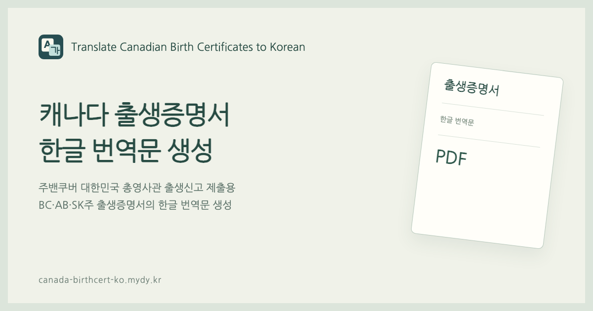

# Translate Canadian Birth Certificates to Korean

캐나다 **브리티시컬럼비아(BC)·알버타(AB)·서스캐처원(SK)** 출생증명서의 내용을 한글로 입력하고, 주밴쿠버 대한민국 총영사관 출생신고에 제출할 번역문 PDF를 만드는 웹 도구입니다.

**[서비스 이용하기](https://canada-birthcert-ko.mydy.kr/)** · [오류 제보](https://github.com/yoobato/mydy-canada-birthcert-ko/issues)



## 지원 범위

| 발급지역 | 지원하는 증명서 |
| --- | --- |
| 브리티시컬럼비아 · BC | 부모 정보 포함·성별 표시형 |
| 알버타 · AB | 부모 정보 포함형 |
| 서스캐처원 · SK | 부모 정보가 포함된 Long form |

- 회원가입 없이 무료로 사용합니다.
- 원본 항목 배치를 참고한 PC·모바일 입력 화면을 제공합니다.
- 한글 PDF 미리보기·다운로드와 주별 가상 샘플을 제공합니다.
- PDF는 Letter 용지에 맞춰 생성하며 번역자 자필 서명란이 있습니다.

## 사용 방법

1. 부모 정보가 포함된 원본 출생증명서를 준비하고 발급지역을 선택합니다.
2. 아이와 부모의 성명·출생지, 등록관 이름을 한글로 입력합니다. SK는 아이의 성과 이름을 Name 한 칸에 함께 입력합니다.
3. 생년월일·등록일·발급일, 성별과 등록번호를 입력합니다. 서식 번호와 증명서 번호는 원본에 맞춰 확인합니다.
4. 번역자 이름을 입력하고 미리보기에서 원본과 대조합니다.
5. PDF를 저장해 Letter 용지에 출력하고 번역자 이름 옆 `(인)`에 자필 서명합니다.

알버타는 모·부 순서, BC·SK는 원본의 부모 1·2 순서에 맞춰 작성합니다. 성별이 남·여 이외의 표기라면 기타를 선택해 원본 표기를 직접 입력할 수 있습니다.

원본과 입력 양식이 다르면 [yoobato@gmail.com](mailto:yoobato@gmail.com)으로 발급지역과 다른 부분을 알려 주세요. 사진을 보내실 때는 성명·날짜·등록번호·서명·바코드 등 개인정보를 가려 주세요.

## 개인정보와 이용 안내

입력값과 PDF는 브라우저 안에서 처리하며 서버에 전송하거나 자동 저장하지 않습니다. 새로고침하면 작성 중인 입력값이 사라집니다. 다운로드한 PDF는 사용자가 관리합니다.

사이트에는 방문·버튼 이용 통계, 배너 광고와 선택적인 커피 후원 기능이 있습니다. 외부 서비스가 쿠키와 기본 접속 정보를 사용할 수 있지만 양식 입력값과 PDF 내용은 통계·광고 매개변수에 포함하지 않습니다. 후원이나 광고 클릭은 PDF 다운로드 조건이 아닙니다.

이 도구는 사용자가 입력한 한글을 번역문 서식에 배치합니다. 정부·영사관 공식 서비스가 아니며 제출 수리 여부를 보장하지 않습니다. 제출 요건은 [주밴쿠버 대한민국 총영사관 출생신고 안내](https://www.mofa.go.kr/ca-vancouver-ko/brd/m_4576/view.do?seq=611226)에서 확인하세요.

## 로컬 실행

Node.js 22.12 이상이 필요합니다.

```sh
npm ci
npm run dev
```

검증과 빌드에는 `npm test`, `npm run build`를 사용합니다. 개발 서버에서는 광고·방문 통계를 비활성화합니다.

## 기여와 라이선스

오류 제보와 변경 제안은 [기여 안내](docs/CONTRIBUTING.md)를 참고하세요. 실제 출생증명서·가족 정보·사용자 PDF·인증정보는 저장소나 공개 이슈에 올리지 마세요.

이 서비스는 AI의 도움을 받아 디자인하고 개발했습니다.

프로젝트 자체에는 별도의 오픈소스 라이선스를 부여하지 않았습니다. 사용한 라이브러리·글꼴은 각각의 라이선스를 따릅니다.

- [라이선스와 외부 자료 출처](LICENSE.md)
- [오픈소스 고지](THIRD_PARTY_NOTICES.md)
- [Nanum Gothic 글꼴 라이선스](public/fonts/OFL.txt)

© [Daeyeol Ryu](https://yoobato.com). All rights reserved.
