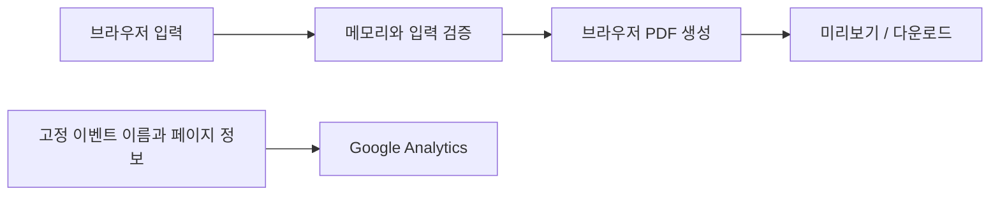

# 구현 구조

## 화면과 입력

BC·알버타·SK 출생증명서의 항목 배치를 참고한 입력 화면과 번역문 준비 패널을 제공합니다. PC·모바일 화면에 대응합니다.

| 입력 항목 | 처리 |
| --- | --- |
| 성·이름 | BC·AB는 성과 이름을 분리, SK는 Name 한 칸에 전체 성명 |
| 생년월일·등록일·발급일 | 달력 선택, 유효 날짜·윤년·시간 순서 검증 |
| 성별 | 남·여 또는 기타 선택, 기타는 원본 표기 직접 입력 |
| 아이 출생지 | 도시를 한글로 입력 |
| 부모 성명 | 알버타는 모·부, BC·SK는 원본 순서대로 부모 1·2 |
| 부모 출생지 | 알버타는 국가, BC·SK는 원본에 적힌 출생지를 한글로 입력 |
| 등록관·번역자 | 한글 직접 입력 |
| 등록번호 | 원본 번호 입력 |
| 서식 번호·일련번호 | 원본 확인 후 입력하는 선택 항목 |

한국어 이름과 출생지는 완성형 한글·호환 자모·조합 자모를 한글로 인식하고 영문 입력을 검사합니다. 오류는 필드별로 수집해 해당 입력칸 아래에 표시하며 aria-invalid와 오류 설명을 연결합니다. 등록관과 번역자 이름은 별도 메시지로 안내하고 날짜 순서 오류는 등록일 또는 발급일에 표시합니다. 길이 제한은 각 입력칸의 maxlength와 동일하게 검사합니다. 필수 항목은 BC·AB 14개, SK 13개입니다. 기타 성별을 선택하면 직접 입력 한 항목이 추가됩니다. `fieldsFor`가 지역별 항목을 정하고 검증과 화면이 함께 사용합니다.

## PDF

`src/pdf.js`는 pdf-lib와 @pdf-lib/fontkit을 사용합니다. 브라우저에서 612 × 792 pt(Letter)의 한 페이지 PDF를 생성합니다.

- 날짜를 `년 월 일` 형식으로 출력합니다.
- 성·이름·생년월일 등 항목 제목은 일정한 영역에 정렬합니다.
- 등록관 이름·직책과 출생기록 추출 안내는 각 영역의 가운데에 배치합니다.
- 알버타·캐나다 표기를 우측 정렬하고, 일련번호는 자간을 넓혀 배치합니다.
- 번역자 이름을 표에 넣고 자필 서명용 연한 `(인)`을 표시합니다.
- 원본의 관인·서명·바코드 이미지·보안 무늬는 출력하지 않습니다.
- Nanum Gothic 전체 글꼴을 포함합니다. 한글 표시를 위해 전체 글꼴을 사용하므로 PDF 파일 크기가 커질 수 있습니다.
- 미리보기는 생성한 PDF를 표시하며, 본문 다운로드 버튼과 미리보기 저장 링크를 지원합니다.

사용자가 입력한 한글을 정해진 서식에 배치하는 기능입니다. 원본 문서 OCR, 자동 번역, 번역 정확성·제출 수리 여부 판정 기능은 없습니다.

## 지역별 원본

BC는 부모 정보 포함형(Parental Birth Certificate)의 공식 견본을 참고합니다. 성별 표시형만 지원하며 성별 입력과 PDF 표시는 필수입니다. BC 입력 화면은 옅은 청색 바탕을 사용하며 출생지 예시는 밴쿠버·빅토리아입니다. 등록번호는 Registration Number, 성별은 MALE·FEMALE로 표시하고 다른 성별 표기는 기타를 선택해 직접 입력할 수 있습니다. 등록관 직책은 Registrar General of Vital Statistics, 출생기록 등록지는 Victoria, British Columbia, Canada로 구분합니다. BC 서식 번호 기본값은 사용자 지정값 `VSA 434 (24/04)`이며 원본과 다르면 수정하거나 비워 둘 수 있습니다. 알버타에는 별도 DVS 기본값을 사용합니다.

선택 버튼은 BC(기본값)·알버타·SK 순서입니다. `?region=ab`, `?region=sk`는 해당 주를 직접 엽니다. 각 입력 영역 하단에서 해당 주의 부모 정보 포함형 공식 견본을 새 창으로 열 수 있습니다. BC는 성별 표시형 견본을 제공합니다.

지역을 전환하면 각 지역의 작성 내용을 탭 메모리에 임시 보관하고, 재선택 시 복원합니다. 지역이 바뀌면 기존 PDF Blob URL을 폐기합니다. 새로고침하면 임시 입력은 사라집니다. 지역을 지정해 열 때는 `?region=bc`를 사용할 수 있으며 쿼리를 통계에 전달하지 않습니다.

공식 견본: [BC 정부 출생증명서 안내](https://www2.gov.bc.ca/gov/content/life-events/birth-adoption/births/birth-certificates). BC 원형 장식과 기하학 무늬는 자체 그래픽이며 공식 관인 복제가 아닙니다. 원본 견본은 저장소에 포함하지 않습니다.

SK는 부모 정보가 포함된 Long form을 지원합니다. Name은 전체 성명 한 필드이고, 부모 성명과 출생지를 좌우 같은 너비에 배치합니다. PDF도 본문 519pt를 좌우 259.5pt로 나누며 각 항목명 셀은 81pt입니다. 서식 번호 기본값은 `V.S. 15 2019/08`이며 수정하거나 비울 수 있습니다. 등록관 이름은 직접 입력하고 placeholder는 제니퍼 린덴바흐입니다. 인증 문구의 Regina는 발급 장소이며 아이의 출생 도시와 별개입니다. 원형 문양은 자체 장식이고 PDF에는 복제하지 않습니다.

## 데이터 흐름

입력값과 PDF 내용은 통계 경로로 전달하지 않습니다. 양식용 localStorage·서버 저장·외부 번역 API는 사용하지 않습니다. 새로고침 시 양식값이 사라집니다.

## 배포·통계·검색

- Vite로 정적 파일을 빌드하고 GitHub Actions → GitHub Pages로 배포합니다.
- 대표 도메인은 `https://canada-birthcert-ko.mydy.kr/`이며 HTTP 접속을 HTTPS로 전환합니다.
- GA4의 방문·미리보기·다운로드·후원 버튼 클릭 이벤트만 명시적으로 전송합니다. 개발 서버에서는 비활성화합니다.
- HTML에 제목·설명·canonical·Open Graph·X 카드·WebApplication JSON-LD를 포함합니다.
- robots.txt와 sitemap.xml을 제공하고 JavaScript 미사용 시 초기 안내를 표시합니다.
- 공유 이미지는 1200 × 630 PNG입니다. HTML/CSS와 로컬 글꼴·자체 로고로 재생성하며 실제 개인정보를 넣지 않습니다.

운영 명령과 설정은 [MAINTENANCE.md](MAINTENANCE.md), 라이선스는 [LICENSE.md](../LICENSE.md)를 참고하세요.

## 검증 범위

단위 테스트는 날짜·한글 입력·필수값·GA 허용 이벤트·개인정보 제외·개발 모드 비활성화를 확인합니다. 브라우저 검증은 PC·모바일 레이아웃, 입력 진행률, 미리보기·다운로드, 초기화, 날짜 순서 및 영문 등록관 입력 오류를 확인합니다. Google 태그는 테스트에서 대체합니다.

CI는 단위 테스트와 프로덕션 빌드를 실행합니다. 지역별 브라우저 검증은 성별 필수 입력과 PDF, 기타 표기의 필수 입력·PDF 반영·선택 변경·지역별 초안 복원, 모바일 너비, 로컬 광고·통계 미실행을 확인합니다. 브라우저 검증과 생성 이미지 시각 확인은 별도 실행합니다. 실제 GA 계정 보고서, 각 공유 플랫폼의 캐시, 검색엔진의 색인, 영사관 제출 결과는 자동 테스트의 확인 범위가 아닙니다.
